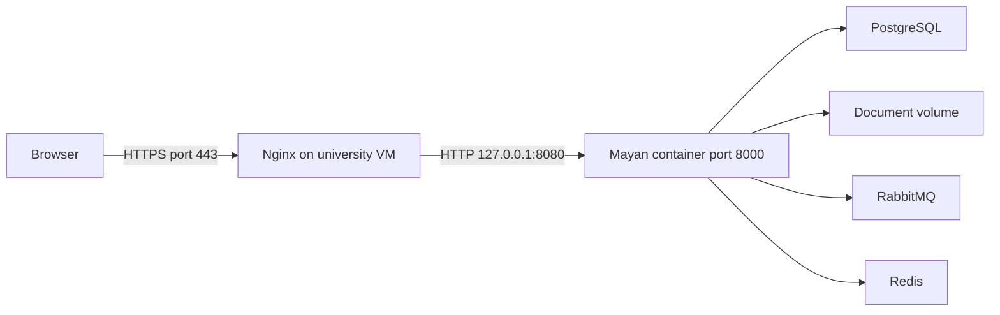

# Heritage ECM: development and deployment learning guide

For Team 05. This guide explains the project as of October 23, 2026. Read it
first, then use the [deployment runbook](deployment-pipeline.md) for releases.

## 1. What we are building

Mayan EDMS manages documents: uploads, metadata, versions, search, OCR, and
permissions. Our future custom application will add archaeological workflows,
such as finding a site, its artifacts, and their related reports and photographs.
We should configure Mayan's existing features before writing replacements.

Today, Mayan runs on the university VM. A custom React frontend and Java or
Python backend have not yet been built or added to the deployment pipeline.

## 2. What each component does, and why we use it

| Component | Simple meaning | Its role in our ECM |
| --- | --- | --- |
| Laptop | Development computer | Write code, run focused tests, review changes, and use Git. It does not have to run the whole production stack. |
| VM | A server provided as a virtual machine | Keeps the shared platform available independently of a team member's laptop. Our recorded allocation is 4 CPUs and 8 GB RAM; capacity still needs monitoring. |
| Git / GitHub | Change history / shared repository | Stores reviewed code, configuration templates, workflows, and documentation. It is not the document repository or a backup of VM data. |
| Docker image | A packaged application and its dependencies | Makes deployments repeatable without installing a development toolchain on the VM. |
| Container | A running instance of an image | Runs Mayan, PostgreSQL, RabbitMQ, or Redis. |
| Docker Compose | A description of related containers | Defines services, environment, networks, ports, health checks, and persistent volumes. |
| Rootless Docker | Docker running under a normal user account | Our deployment runs as `parmar7f`, using the `rootless` context. Use that account rather than `sudo docker`. |
| Volume | Storage outside a container's disposable filesystem | Preserves documents and database contents when containers are recreated. A volume is not an off-server backup. |
| Nginx | Public web server and reverse proxy | Accepts HTTPS requests and forwards them to Mayan's private local port. It can later route requests to our custom application too. |
| PostgreSQL | Database | Stores Mayan's document metadata, accounts, and application state. Document files live in Mayan's storage volume. |
| RabbitMQ | Task message broker | Passes background jobs to workers, keeping long work separate from web requests. |
| Redis | Supporting coordination service | Used here for task results, locks, and server-side event state. |

## 3. How a request reaches Mayan today



Public address: https://archeoecm.cs.uwindsor.ca

Nginx handles the public TLS certificate. Its connection to Mayan stays inside
the VM. Binding Docker to `127.0.0.1:8080` means remote users cannot directly
connect to that port. They use Nginx's HTTPS address instead.

The HTTPS login incident showed why the two applications must agree about the
original request. Nginx sent `X-Forwarded-Proto: https`, but Mayan did not trust
that header and had no trusted HTTPS origin. Login returned HTTP 403 through
the public address while the same credentials worked through an SSH tunnel.
The verified fix is recorded in the shared environment in the
[production Compose file](../infra/mayan/production/docker-compose.yml):

```yaml
environment:
  <<: [*mayan-environment]
  MAYAN_SECURE_PROXY_SSL_HEADER: '["HTTP_X_FORWARDED_PROTO", "https"]'
  MAYAN_CSRF_TRUSTED_ORIGINS: '["https://archeoecm.cs.uwindsor.ca"]'
```

Keep the environment merge and Nginx's header override. Do not disable CSRF
protection to fix login. A successful HTTP health check alone does not prove
that login, upload, or permissions work.

## 4. Where files belong

| Location | Contents |
| --- | --- |
| Laptop repository | Source code, tests, configuration templates, and documentation |
| GitHub `infra/mayan/` | Laptop development configuration |
| GitHub `infra/mayan/production/` | Recorded production Compose file and example environment |
| VM `~/ECM_Archeology/deployment/mayan/` | Live `docker-compose.yml`, private `.env`, and optional `.env-local` |
| VM Docker volumes | Persistent documents and database data |
| VM `~/actions-runner/` | GitHub runner software |
| University-approved separate storage | Intended backup destination; backup and restore still need to be configured and tested |

The VM normally runs packaged images rather than a source checkout. GitHub and
VM directory names do not need to match. An explicit release procedure must
move configuration or images between them. Never replace the live `.env` with
`.env.example`; example passwords do not update existing database credentials.

## 5. Why GitHub Actions, rulesets, approvals, and runners exist

**GitHub Actions** executes repeatable tasks defined in `.github/workflows/`.
Logs show what ran and whether it passed. It reduces dependence on remembering
manual commands, but it only automates what we explicitly put in the workflow.

**CI (continuous integration)** checks a proposed change. Our
[CI workflow](../.github/workflows/ci.yml) runs on PRs targeting `main` and pushes
to `main`. It checks whitespace, selected prohibited file paths, and both Mayan
Compose configurations. The path check is not a complete secret scanner. CI
does not yet build or test React, Java, or Python application code.

**A ruleset / branch protection rule** controls what may enter `main`. Our team
policy is branch → PR → successful required checks → review → merge. This keeps
the shared branch reviewable. The actual enforcement is in GitHub Settings,
not just in this document. Keep direct pushes, force pushes, and bypasses
restricted according to the repository's policy.

**CD (continuous delivery)** prepares or performs deployment. Our current
[CD workflow](../.github/workflows/deploy-mayan.yml) is manually started; merging
a PR does not deploy anything. It offers `validate` and `deploy` operations.

**A runner** is the computer executing a workflow job. CI uses GitHub's
`ubuntu-latest` runner. Deployment uses our VM runner `archeoecm-runner`, selected
by the `ecm-deploy` label. It can reach rootless Docker and private VM files
locally; GitHub does not need to SSH into the VM for each deployment. Keep PR
jobs on GitHub-hosted runners: unreviewed code must not execute on the live VM.

**The production approval gate** is a separate decision from PR approval:

| Gate | Question it answers |
| --- | --- |
| PR review and required CI | Is this change ready to enter `main`? |
| `mayan-production` environment approval | Should production deployment run now? |

Our recorded environment setup uses the repository owner as approver, allows
the owner to approve their own run, restricts deployments to `main`, and disables
administrator bypass. Verify these settings under Settings → Environments when
maintaining the repository. The workflow references the environment; the
required-reviewer rule itself is configured in GitHub.

## 6. The exact deployment flow today

```text
Laptop branch → push → PR → CI + review → merge into main
                                               |
                          operator starts workflow manually
                                               |
                       validate VM Docker, Compose, and .env
                                               |
                         deploy selected? → owner approval
                                               |
                           pull images → compose up -d
                                               |
                           local HTTP check → manual login test
```

1. Start the VM runner using the command below.
2. In Actions → **Deploy Mayan to university VM**, select **Run workflow**, branch
   `main`, operation `validate`. This checks configuration without changing services.
3. Start another run with operation `deploy` when ready.
4. After validation passes, select **Review deployments**, choose
   `mayan-production`, and **Approve and deploy**.
5. The workflow pulls configured images, runs Compose, and checks the local URL.
6. Confirm public login and a representative document operation. Record the run
   link and outcome. Stop an interactive runner only after its jobs finish.

Important limits: the current workflow does not copy GitHub's Compose file to
the VM, publish custom images, or check out custom application code. Future
Compose changes still need a reviewed manual file-copy step; that file-copy
step is outside the Actions gate. Follow the
[production configuration instructions](../infra/mayan/production/README.md).
The gate pauses the deployment job, not ordinary commands entered through SSH.
Image tags can change; the current image pull does not by itself identify an
immutable release. There is no automated rollback or verified backup procedure.

## 7. Everyday VM commands

Run the SSH command on your laptop. Run the remaining Linux commands on the VM
as `parmar7f`. These commands are for the existing installation, not a new VM.

```bash
ssh parmar7f@archeoecm.cs.uwindsor.ca
cd ~/ECM_Archeology/deployment/mayan
```

### Check Docker and the application

```bash
docker context show
docker info --format '{{json .SecurityOptions}}'
docker compose -p archeoecm -f docker-compose.yml ps -a
docker stats --no-stream
df -h .
curl --max-time 10 -sS -o /dev/null -w 'HTTP %{http_code}\n' http://127.0.0.1:8080/
```

Expect context `rootless`, running services, and normally HTTP 200 or 302.
Check memory and disk before assuming every slowdown requires a restart.
Always keep `-p archeoecm`: a different project name can create a duplicate
stack, select different volumes, and cause a port conflict.

### Read logs

```bash
docker compose -p archeoecm -f docker-compose.yml logs --since=10m --tail=100 app
docker compose -p archeoecm -f docker-compose.yml logs --tail=100 postgresql
```

Use `logs -f app` to follow new output; Ctrl+C exits log viewing without
stopping Mayan. Redact credentials and personal data before sharing logs.

### If containers stopped

For an existing stopped stack, this starts its existing containers:

```bash
docker compose -p archeoecm -f docker-compose.yml start
```

If containers are missing or reviewed configuration must be applied, prefer the
approved deployment workflow. The equivalent direct recovery command is below;
it can create/recreate containers and is a manual production action outside
the approval gate. Record its use and do not run it alongside an active deployment.

```bash
docker compose -p archeoecm -f docker-compose.yml config --quiet
# Continue only if validation succeeds.
docker compose -p archeoecm -f docker-compose.yml up -d
```

To restart only a running Mayan app after inspecting logs:

```bash
docker compose -p archeoecm -f docker-compose.yml restart app
```

`restart` briefly interrupts Mayan and does not apply changed environment
settings. Applying those requires container recreation through `up -d`.
Do not use `down -v` or volume-pruning commands for troubleshooting: volumes
contain persistent data. Stopping/restarting a container is not deleting data.

### If the rootless Docker daemon stopped

```bash
systemctl --user status docker --no-pager
systemctl --user start docker
docker --context rootless info
```

These require the rootless Docker user service to have been installed. If the
unit is missing, inspect the original rootless setup rather than starting a
separate system Docker daemon. For startup after logout/reboot, an administrator
should verify the user service is enabled and lingering is configured; test a
planned reboot rather than assuming persistence from container restart policies.

### Start or stop the GitHub runner

In a separate VM SSH terminal:

```bash
cd ~/actions-runner
./run.sh
```

Wait for `Listening for Jobs`; GitHub should show the runner as Idle. Keep this
terminal open during workflows. After jobs finish, Ctrl+C stops the interactive
runner. **Stopping the runner does not stop Mayan.** Closing your laptop may
disconnect the interactive runner, but the VM's application containers continue
provided Docker remains running. A managed runner service can be configured
later; do not launch a duplicate interactive runner if one is already running.

### Check Nginx when local HTTP works but HTTPS fails

```bash
sudo nginx -t
sudo systemctl status nginx --no-pager
sudo tail -n 50 /var/log/nginx/error.log
sudo tail -n 30 /var/log/nginx/access.log
```

If Nginx is stopped and its configuration test succeeds, an authorized operator
can run `sudo systemctl start nginx`. After a reviewed Nginx configuration edit,
test first and use `sudo systemctl reload nginx`. These commands require VM sudo
rights; GitHub repository administrator access does not grant VM sudo access.

## 8. Adding React and Java or Python next

React provides the browser interface. Pick one primary backend initially:
Java/Spring Boot fits the current project direction; Python/FastAPI or Django
is an alternative if team skills and requirements support it. Mayan being
written in Python does not require our application to use Python.

Proposed request flow, not deployed yet:

```text
Browser → Nginx → React interface
Browser → Nginx → custom backend → Mayan REST API
                              → optional domain database
```

Example: React requests reports for a site. The backend checks the user's
permissions, looks up site relationships, and requests the permitted documents
from Mayan. React displays the results. Keep privileged Mayan API credentials
in backend secrets, never in the React bundle. A service credential does not
automatically enforce each end user's permissions; design and test that boundary.
Do not write directly to Mayan's database. Keep files in Mayan, and store Mayan
document IDs for relationships if a separate domain database is needed.

To make deployment support this application, we still need to:

1. Add frontend/backend directories, dependency lockfiles, tests, and Dockerfiles.
2. Extend PR CI to build and test the chosen frontend and backend.
3. After merge, build images tagged with the Git commit and publish them to a
   registry such as GitHub Container Registry. Record their immutable digests.
4. Add VM Compose services, resource limits, private configuration, and health
   checks. Add separate domain storage only when requirements justify it.
5. Configure Nginx routes without breaking Mayan's existing paths. For example,
   use a distinct custom application route or hostname; decide the route scheme
   before implementation because Mayan already uses its own API and UI routes.
6. Extend CD to select the tested release and deliver reviewed configuration,
   wait for approval, pull those exact images, and update the custom services.
7. Verify public UI, backend health, Mayan integration, and authorization. Define
   rollback and backup/migration recovery before deploying database changes.

The VM then needs Docker, configuration, secrets, persistent storage, and Nginx
routes. It normally does not need Node, Maven, an IDE, or source builds on the
host; runtime dependencies are packaged inside the images.

## 9. An efficient team workflow

Configure Mayan metadata, document types, and permissions first. Build one small
end-to-end feature next: display permitted documents for a site. Use mocked API
responses for fast laptop tests and a controlled test dataset for integration
tests. Avoid running destructive development tests against shared production.

Use small PRs with a clear problem, change, and test result. Deploy one reviewed
release at a time and record its commit, image versions, approver, and outcome.
Keep the deployment guide current when automation changes. A green pipeline
means its implemented checks passed; complete the user-facing verification too.

## Quick answers

| Question | Answer |
| --- | --- |
| Does merging into main deploy today? | No. Start the deployment workflow manually and approve it. |
| Does saving Compose in GitHub change the VM? | No. The current workflow reads the VM's existing file. |
| Does the runner host the website? | No. Docker runs Mayan; the runner executes workflow jobs. |
| Is the VM a backup? | No. Configure and test backups to a separate approved location. |
| Can Java work with Mayan? | Yes, through its REST API. Python is also an option. |
| Can we deploy React/Java today using the current workflow? | Not yet. Add builds, images, services, routing, and application deployment steps. |
| Is protected main enough to protect deployment? | No. PR controls and the production approval gate serve different purposes. |
